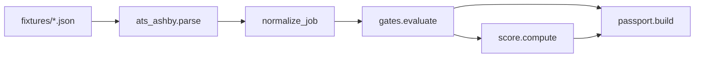

# Intent Radar (portfolio)

Small, **offline** Python library that turns Ashby-style job JSON into normalized leads, runs transparent rule gates, scores intent 0–100, and emits an **evidence passport** (quotes from the source document only).

No live scraping, no client data, no production integrations — suitable for demos and technical interviews.

## Demo

**Preview (offline):** run `pytest -q` or `make verify`, then inspect the JSON **passport** printed in tests — it is the demo artifact (quoted fields only, no network).

---

## What It Does

- Parses Ashby job board JSON from **local fixtures**
- Normalizes **company**, **role**, and **location**
- Applies three rule gates: **headcount band**, **tool keywords**, **pay signal**
- Produces a **0–100 rule score** with a per-gate breakdown
- Builds a JSON **passport** with quoted fields from the posting

---

## Architecture



---

## Trade-offs

- **Rule gates vs ML:** Explainable PASS/FAIL and fixed weights — not adaptive ranking (intentional for auditability).
- **Fixtures only:** CI-safe and fast; live Ashby API collection is a separate adapter, not in this repo.
- **Portfolio scope:** Small library surface — wiring schedulers and CRM export is left to the hiring team's stack.

---

## Project Layout

```text
intent_radar/
  ats_ashby.py    # fixture load + parse
  normalize.py    # company / role / location
  gates.py        # headcount, tools, pay
  score.py        # 0–100 rule score
  passport.py     # evidence dict
fixtures/
  sample_ashby_job.json
tests/
  test_*.py
```

---

## Quick Start

```bash
python -m venv .venv
.venv\Scripts\activate   # Windows
pip install -e ".[dev]"
pytest -q
```

Or:

```bash
make verify
```

---

## Portfolio / Hire Me

This repo shows how I structure **evidence-first** lead qualification:

- Gates are pure functions with explicit PASS/FAIL
- Scores are explainable (weights per gate)
- Passports separate **source quotes** from **inference**

If you are hiring for backend automation, integrations, or data pipelines — this is the kind of small, testable module I ship before wiring network collectors.

**Contact:** open an issue on the GitHub repo or reach out via the profile linked from this portfolio.

---

## License

MIT — see [LICENSE](LICENSE).
